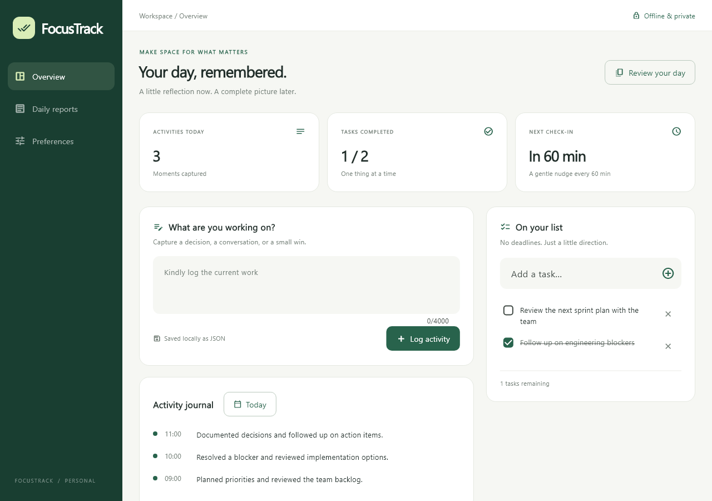
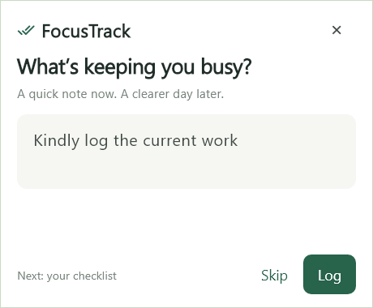
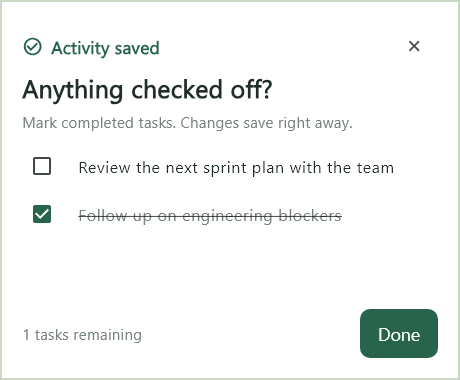
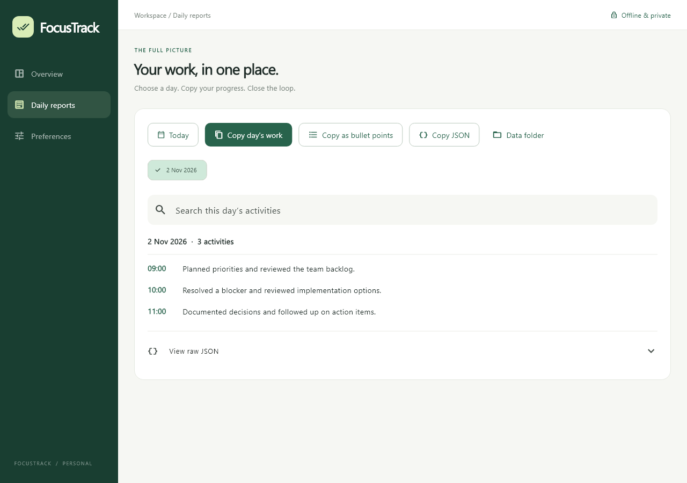
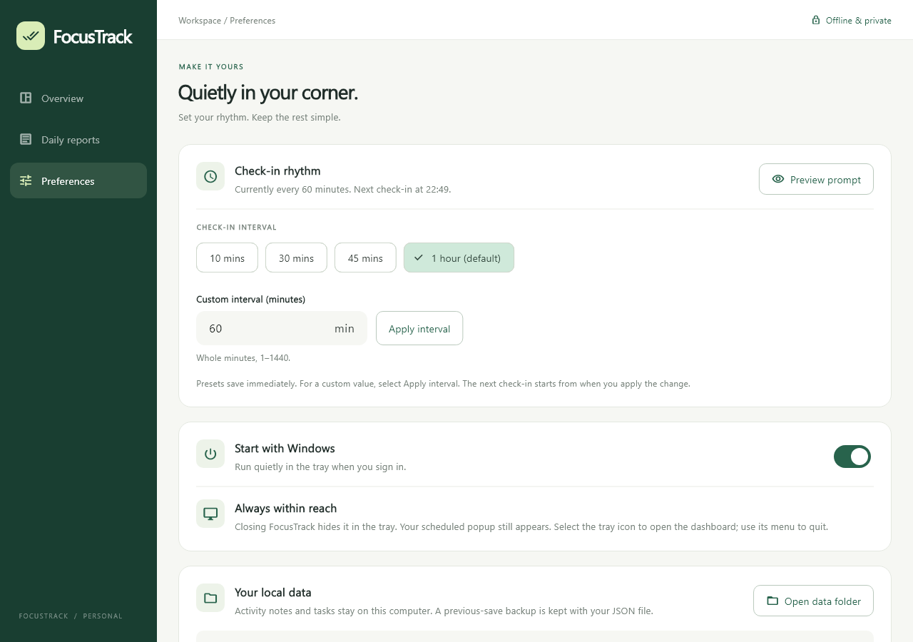

# FocusTrack

**Remember your workday, one quick check-in at a time.**

FocusTrack is a free, open-source Windows desktop app that helps you capture what you worked on throughout the day. It runs quietly in the system tray, prompts you at an interval you choose, and turns your notes into a daily summary you can copy into a stand-up update, work journal, or status report.

No account. No cloud sync. No activity monitoring. Your notes stay on your computer.

## Why use it?

Busy days rarely follow a single task list. You might review a document, help a colleague, resolve a blocker, join a meeting, and return to your own work—all before lunch. By evening, useful details are easy to forget.

FocusTrack gives you a small moment to record them while they are fresh. It can help:

- **Team leads and managers** remember decisions, reviews, mentoring, and follow-ups.
- **Engineers and designers** capture progress, investigation, and collaboration.
- **Freelancers and students** keep a lightweight record of daily accomplishments.
- **Anyone switching between tasks** write an end-of-day update without reconstructing the whole day.

This is a manual work journal—not an automatic time tracker, timesheet, or employee-monitoring tool.

## A simple daily routine

1. Start FocusTrack. It stays in the tray; select its icon to open the dashboard.
2. When the bottom-right popup appears, write a short note and choose **Log**.
3. Review your to-do list in the next popup and check off completed items.
4. At the end of the day, open **Daily reports**, choose a date, and copy your work.

**Skip** or close the activity popup to dismiss that check-in without saving an activity. Closing the main window keeps FocusTrack running; use **Quit** in the tray menu to exit.

## Features

- **Customizable reminders:** 10, 30, 45, or 60 minutes, plus custom intervals from 1 to 1440 minutes. Default: one hour.
- **Compact check-ins:** a text field with Log and Skip, positioned above the taskbar.
- **To-dos without deadlines:** add tasks and check them off from the dashboard or post-log popup.
- **Daily reports:** browse by date and search your notes.
- **Three copy formats:** timestamped summary, plain-text bullet points, or JSON.
- **Offline storage:** local JSON, a previous-save backup, and recovery handling.
- **Tray and startup support:** run quietly when you sign in to Windows.
- **Responsive UI:** layouts tested at narrow widths and increased text size.

## Screenshots

These images are rendered from the app's widget tests using **fictional sample data**. They illustrate the UI; native window frames and taskbar placement depend on your Windows setup.

### A quick check-in, then your checklist

| Capture your current work | Review completed tasks |
| --- | --- |
|  |  |

### Your day, ready to share

### Choose your rhythm

## Download and run

Visit [Releases](https://github.com/Anantha-Gokula-Raman-J/FocusTrack/releases) for available Windows x64 portable builds.

1. Download the ZIP.
2. Extract **the entire folder** to a location you will keep.
3. Run **focustrack.exe**.
4. Find FocusTrack in the tray/hidden icons to open the dashboard.

Flutter and Visual Studio are **not needed to use a packaged release**. Keep all DLLs and the data folder beside the executable. Builds are currently unsigned.

Quit an older instance from its tray menu before launching an update. If you move the extracted folder, launch FocusTrack again so an enabled startup entry can refresh its executable path.

## Privacy and your data

FocusTrack does not capture screenshots, inspect other apps, track keystrokes, or send activities to a server. You enter each note yourself.

Data is stored at:

~~~text
%APPDATA%\FocusTrack\focustrack.json
~~~

Open the data folder from the app. Notes, tasks, reminder settings, and the next reminder time live in this file. A .bak file holds the previous saved version.

The JSON is **not encrypted**. Anyone with access to your Windows user files may be able to read it. Avoid recording passwords or confidential information you are not allowed to store locally. Back up important data separately.

Older Daymark data is copied into FocusTrack on first migration when no current data exists; originals are preserved.

## Build from source

### Prerequisites

- Windows 10/11 **x64**.
- Git.
- Flutter on PATH, with Dart **3.13.5 or newer, below 4.0**, matching pubspec.yaml. The current release was built with **Flutter 3.47.7**.
- **Visual Studio** with **Desktop development with C++**, CMake tools, and a Windows SDK. Visual Studio Code alone does not provide the native compiler.

Follow Flutter's [official Windows setup guide](https://docs.flutter.dev/platform-integration/windows/setup), then check:

~~~powershell
flutter doctor -v
flutter devices
~~~

### Clone, test, and build

~~~powershell
git clone https://github.com/Anantha-Gokula-Raman-J/FocusTrack.git
cd FocusTrack
flutter pub get
flutter analyze
flutter test --concurrency=1
flutter build windows --release --no-tree-shake-icons
~~~

The executable is created at:

~~~text
build\windows\x64\runner\Release\focustrack.exe
~~~

Run **Launch FocusTrack.cmd** from the repository after building. The app starts in the tray by design.

Dependencies and the build toolchain may need internet during setup. The application itself runs offline.

## Development checks

Before changing code, read [AGENTS.md](AGENTS.md) and the [specification index](docs/specs/README.md). The [architecture map](docs/specs/architecture.md) maps features to source and tests.

~~~powershell
.\scripts\context.ps1 -Task reports
.\scripts\verify.ps1
~~~

Verification checks architecture boundaries, naming, formatting, static analysis, and tests. Add **-Build** to build Windows Release.

Scripts find Flutter through PATH or FLUTTER_ROOT, or an explicit **-FlutterSdk** parameter. See [verification notes](docs/specs/verification.md) for the optional JIT analyzer fallback used in restricted environments.

### Regenerate screenshots

~~~powershell
$env:UI_SCREENSHOTS = '1'
flutter test test/layout_test.dart --concurrency=1
Remove-Item Env:UI_SCREENSHOTS
~~~

Images go to work/screenshots. Review them before copying selected images to docs/images. Never use personal activity data in public screenshots.

## Project structure

~~~text
lib/
  main.dart       Entry point
  app/            Bootstrap, app composition, theme
  application/    Workflow controller, reminders, commands
  domain/         Models, repository contract, report formatting
  data/           JSON persistence and migration
  platform/       Windows method-channel adapter
  presentation/   Dashboard, reports, preferences, popups
windows/runner/   Native tray, window, startup, single-instance support
test/            Persistence, interaction, layout, failure-path tests
docs/specs/      Feature contracts, source map, edge cases
scripts/         Context, verification, analysis, packaging
~~~

## Package a portable release

Build first. Set FLUTTER_ROOT to your SDK directory and provide the **x64 release CRT directory** from your Visual Studio installation:

~~~powershell
.\scripts\package-windows.ps1 -FlutterSdk $env:FLUTTER_ROOT -RuntimeDirectory "C:\path\to\Microsoft.VCxxx.CRT" -OutputDirectory ".\dist\release-build"
~~~

Choose a fresh output directory. The script includes runtime DLLs, Flutter assets, third-party notices, and a SHA-256 manifest, then creates a ZIP. Do not distribute only the EXE. See [Flutter's distribution guide](https://docs.flutter.dev/platform-integration/windows/building) and [third-party notices](packaging/THIRD-PARTY-NOTICES.txt).

Build outputs, ZIPs, local work files, IDE settings, and personal data are excluded from source control. Publish binaries as GitHub Release assets.

## Contributing

Bug reports, documentation improvements, and focused pull requests are welcome. See [CONTRIBUTING.md](CONTRIBUTING.md).

Use sample data in issues and screenshots. Do not upload activity JSON, credentials, or confidential work details.

## Current scope and limitations

- Windows x64 only; no web, mobile, macOS, or Linux app.
- No cloud sync, accounts, team dashboard, or automatic time accounting.
- Signing, clean-PC testing, sign-in startup, and multi-monitor/DPI behavior require manual release checks.
- Closing the dashboard does not quit the app; this is intentional.

## License

FocusTrack source code is available under the [MIT License](LICENSE). Third-party components retain their respective licenses; see [third-party notices](packaging/THIRD-PARTY-NOTICES.txt).
